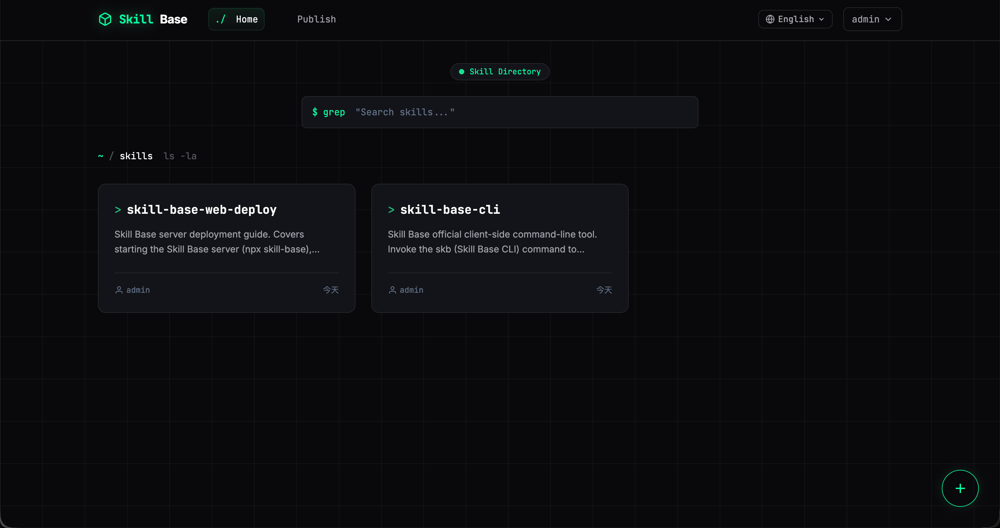

# Skill Base

**English** | [中文](docs/zh/README.md)

[](https://www.npmjs.com/package/skill-base)
[](https://nodejs.org/)
[](#license)

**A self-hosted Agent Skills registry for teams.** Publish a Skill once so teammates using Cursor, Claude Code, Codex, or OpenClaw can find and install the same version.

You fix a Skill, share the new ZIP in chat, and someone still runs last week's copy. With Skill Base, the team has one place to find the current release, see what changed, and download a specific version when a project needs it.

[Browse the hosted instance](https://skillbase.reaidea.com) · [Run your own](#quick-start) · [Connect over MCP](#remote-mcp) · [Download the desktop app](docs/desktop.md)



## How teams use it

- **Publish a release.** Upload a Skill folder or ZIP in the browser, publish with `skb`, or import from a public GitHub repository. Each release gets its own archive and changelog.
- **Share a Skill or a collection.** Give teammates one link for the Skill or a curated pack, such as frontend onboarding. They can download a ZIP, copy installation instructions for their agent, or install with `skb`.
- **Manage updates and access.** Inspect files and compare versions before updating. Keep internal Skills private, grant collaborators publishing access, and select a previous release when you need to roll back.

## Quick start

Start the server and open [localhost:8000](http://localhost:8000) to create the first admin account.

```bash
npx skill-base -d ./skill-data -p 8000
```

From a project folder, use the CLI to publish and install a Skill. This example uses a folder named `team-review` containing a `SKILL.md` with the same name in its frontmatter.

```bash
npm install -g skill-base-cli
skb init -s http://localhost:8000
skb login
skb publish ./team-review --changelog "First release"
skb install team-review --ide cursor
```

You can also upload and download from the Web UI. The server stores its SQLite database and ZIP archives in the data directory. See [Getting Started](docs/getting-started.md) and [Deployment](docs/deployment.md) for setup and backups.

## Remote MCP

Open **MCP & Skills** in the Web navigation to copy your instance's Streamable HTTP endpoint and an agent setup prompt. Connected agents can search Skills, browse collections, read files, and compare an installed version with the current release. With a personal access token, they can also access private Skills or publish according to their permissions. See the [MCP setup guide](docs/zh/api.md#远程-mcp).

## Documentation

| Doc | Contents |
|-----|----------|
| [Getting Started](docs/getting-started.md) | Server, CLI, first install/publish |
| [Usage](docs/usage.md) | Web UI, desktop app, GitHub import, OpenClaw prompts, Skill format |
| [Deployment](docs/deployment.md) | Docker, PM2, flags, sessions, backup |
| [Architecture](docs/architecture.md) | Data model and stack choices |
| [Desktop](docs/desktop.md) | Download, copy or link skills, and use shared CLI profiles |
| [CLI](docs/zh/cli.md) | `skb` command reference (中文) |
| [API](docs/zh/api.md) | HTTP API (中文) |
| [Changelog](CHANGELOG.md) | Server / npm release notes |
| [Author](docs/author.md) | Maintenance contract, Author's Lab |
| [Docs index](docs/README.md) | Bilingual documentation map |

中文入口：[docs/zh/README.md](docs/zh/README.md)

## License

[MIT](package.json) · [About the author and maintenance](docs/author.md)
