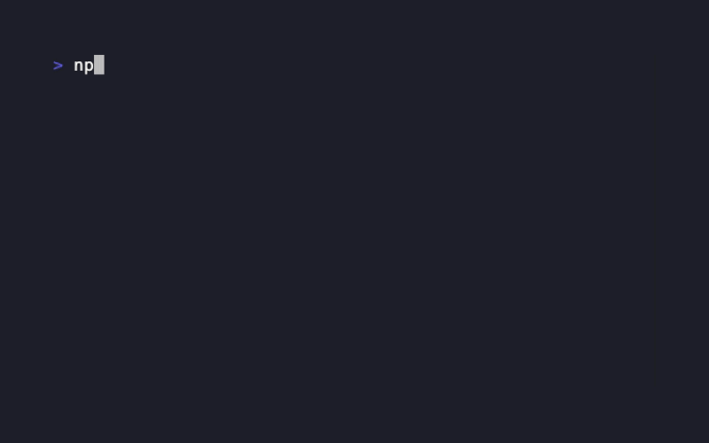

# Skill Base

[English](../README.md) | **中文**

[](https://www.npmjs.com/package/skill-base)
[](https://nodejs.org/)
[](../LICENSE)

> 面向团队的 Agent Skill 私有分发平台。一次发布，在 Cursor、Claude Code、Codex、OpenClaw 等助手上安装、更新、回滚 —— 一个小服务端 + `skb` CLI 就够。

<p align="center">
  
</p>

## 为什么需要

很多团队已经攒了几十个、上百个 Skill，但它们还不是团队资产，只是散在聊天记录、个人电脑、项目目录里的 Markdown。有人从群里下载，有人复制同事的旧版本，有人直接改本地那份。时间一长，没人说得清哪份是最新、谁改过、哪些项目还在用旧版。

有的团队改成用 Git 管，确实会好一些，至少有提交记录和集中仓库。但 Git 解决的是“文件放哪”，不是“团队怎么用”，很难解决不同Agent工具 skill 目录的碎片化问题。Skill 真正麻烦的地方在分发、安装、更新和权限：

- **分发靠人** — 发 zip、转 Markdown、让新人去问“最新版在哪”。
- **版本靠猜** — `final`、`final2`、`最新版` 到处都是，本地改动没有记录。
- **路径靠记** — Cursor、Claude Code、Qoder 等 skill 路径不一致，安装和更新全凭经验。
- **权限卡业务同学** — PM、QA 也要用规范，但不该为了拿一个 Skill 去开仓库权限、学 Git 流程。
- **更新断在本地/本项目** — 一个人修了 Skill，其他项目、其他同事还在用旧版，项目A改了目录下的 Skill 但没有同步到项目B。

Skill Base 把 Skill 变成**可发布、可版本化、可安装**的团队资产。

## 能做什么

| 能力 | 方式 |
|------|------|
| **发布** | 通过Web 上传、`skb publish`、公开 GitHub 仓库导入 Skill |
| **安装 / 更新** | `skb install` / `skb update`，记住 IDE Skill 路径与本地安装记录；公开 Skill 详情页也提供所选版本的 `npx skills add <ZIP 地址>` 命令 |
| **浏览** | Web 端搜索、切换版本、changelog、标签、收藏 |
| **桌面端** | 原生桌面客户端 — [下载](desktop.md) |
| **可见性** | `public` / `private`；owner / collaborator / user 权限 |

<p align="center">
  
</p>

## 快速开始

**服务端**（Node.js >= 18）：

```bash
npx skill-base -d ./skill-data -p 8000
```

浏览器打开地址，完成初始化并创建管理员。

**CLI：**

```bash
npm install -g skill-base-cli
skb init -s http://localhost:8000
skb search vue
skb install some-skill --ide cursor
skb login    # 发布前需要
skb publish ./my-skill --changelog "首次发布"
```

详见 [快速开始](getting-started.md) · CLI 全文：[cli.md](cli.md)

## 设计原则

- **Skill 是分发单元** — 不是通用网盘，也不是 Agent 编排平台。
- **SQLite + ZIP** — `skills.db` 做索引，每个版本一个归档包；备份 = 复制目录。
- **单 Node 进程** — 不为这种规模上 Redis、MySQL、消息队列或微服务。

展开：[架构与设计](architecture.md)

## 文档

| 文档 | 内容 |
|------|------|
| [快速开始](getting-started.md) | 启服、CLI、首次安装与发布 |
| [使用说明](usage.md) | Web 端、桌面端、GitHub 导入、OpenClaw、Skill 格式 |
| [部署与备份](deployment.md) | Docker、PM2、参数、Session、备份 |
| [架构与设计](architecture.md) | 数据模型与技术选型 |
| [桌面客户端](desktop.md) | 下载与功能 |
| [CLI](cli.md) | `skb` 命令参考 |
| [API](api.md) | HTTP API |
| [Webhook 指南](webhook.md) | 配置、事件载荷、本地 Demo |
| [更新日志](../CHANGELOG.md) | 服务端 / npm 版本说明 |
| [作者与维护](author.md) | 维护契约、Author's Lab |

双语索引：[docs/README.md](../README.md)

## Author's Lab

作者的相关项目链接。

| | |
|--|--|
| [skillbase.reaidea.com](https://skillbase.reaidea.com) | 在线 Skill Base |
| [reaidea.com](https://reaidea.com) | 作者主页与后续工具 |

更多见 [author.md](author.md)。

## 维护说明

本项目由**兼职独立开发者**在工作日晚间和周末维护。

欢迎 Issue 和 PR，没有 on-call SLA；范围清晰的小 PR 比大而全的需求更容易合并。

全文：[author.md](author.md)

## 许可

[MIT](../LICENSE)
