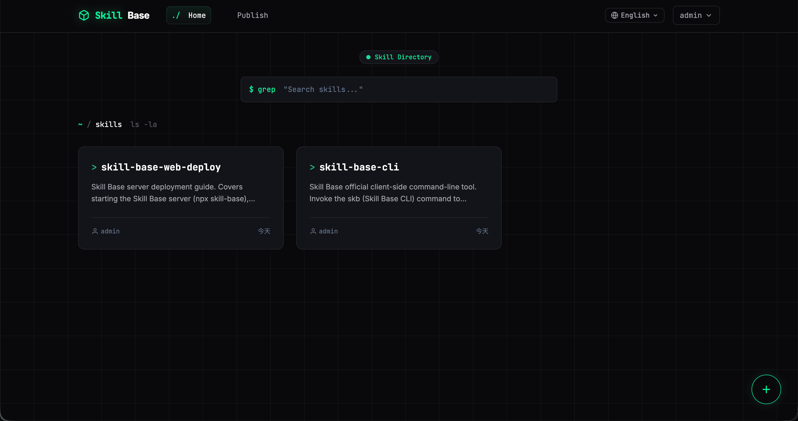

# Skill Base

[English](../README.md) | **中文**

[](https://www.npmjs.com/package/skill-base)
[](https://nodejs.org/)
[](#许可)

**给团队自托管的 Agent Skill 分发平台。** 一次发布，让使用 Cursor、Claude Code、Codex 或 OpenClaw 的同事都能找到并安装同一个版本。

你修好了一个 Skill，把新 ZIP 发到群里，过几天还是有人在用上周那份。用 Skill Base，团队可以从同一个入口找到当前版本、查看更新说明，也能为需要的项目下载指定版本。

[浏览在线站点](https://skillbase.reaidea.com) · [本地启动](#快速开始) · [连接远程 MCP](#远程-mcp) · [下载桌面端](desktop.md)



## 团队怎么用

- **发布一个版本。** 在网页上传 Skill 文件夹或 ZIP，用 `skb` 发布，或者从公开 GitHub 仓库导入。每个版本都有独立的归档和更新说明。
- **发一个 Skill 或一组 Skill。** 把技能详情或集合链接发给同事，例如「前端新人入门」集合。同事可以下载 ZIP、复制给 Agent 的安装提示词，或用 `skb` 安装。
- **管理更新与权限。** 更新前可以查看文件和比较版本。内部 Skill 可设为私有，协作者可以获得发布权限，需要回退时可选择之前的版本。

## 快速开始

启动服务，打开 [localhost:8000](http://localhost:8000) 创建首个管理员。

```bash
npx skill-base -d ./skill-data -p 8000
```

在项目目录中用 CLI 发布和安装。这个示例使用 `team-review` 文件夹，文件夹中有一份 `SKILL.md`，其 frontmatter 中的 `name` 同样是 `team-review`。

```bash
npm install -g skill-base-cli
skb init -s http://localhost:8000
skb login
skb publish ./team-review --changelog "首次发布"
skb install team-review --ide cursor
```

也可以直接在网页上传和下载。服务将 SQLite 数据库和各版本的 ZIP 归档存放在数据目录。部署和备份见[快速开始](getting-started.md)和[部署与备份](deployment.md)。

## 远程 MCP

打开网页导航中的 **MCP 与 Skills**，复制当前实例的 Streamable HTTP 端点和 Agent 配置提示词。连接后的 Agent 可以搜索 Skill、浏览集合、读取文件，以及比较已安装版本与当前版本。配置个人访问令牌后，还可以按账号权限访问私有 Skill 或发布。详见 [MCP 配置说明](api.md#远程-mcp)。

## 文档

| 文档 | 内容 |
|------|------|
| [快速开始](getting-started.md) | 启服、CLI、首次安装与发布 |
| [使用说明](usage.md) | Web 端、桌面端、GitHub 导入、OpenClaw、Skill 格式 |
| [部署与备份](deployment.md) | Docker、PM2、参数、Session、备份 |
| [架构与设计](architecture.md) | 数据模型与技术选型 |
| [桌面客户端](desktop.md) | 下载、本地技能工作区与 CLI 配置切换 |
| [CLI](cli.md) | `skb` 命令参考 |
| [API](api.md) | HTTP API |
| [Webhook 指南](webhook.md) | 配置、事件载荷、本地 Demo |
| [更新日志](../../CHANGELOG.md) | 服务端 / npm 版本说明 |
| [作者与维护](author.md) | 维护契约、Author's Lab |

双语索引：[docs/README.md](../README.md)

## 许可

[MIT](../../package.json) · [作者与维护说明](author.md)
