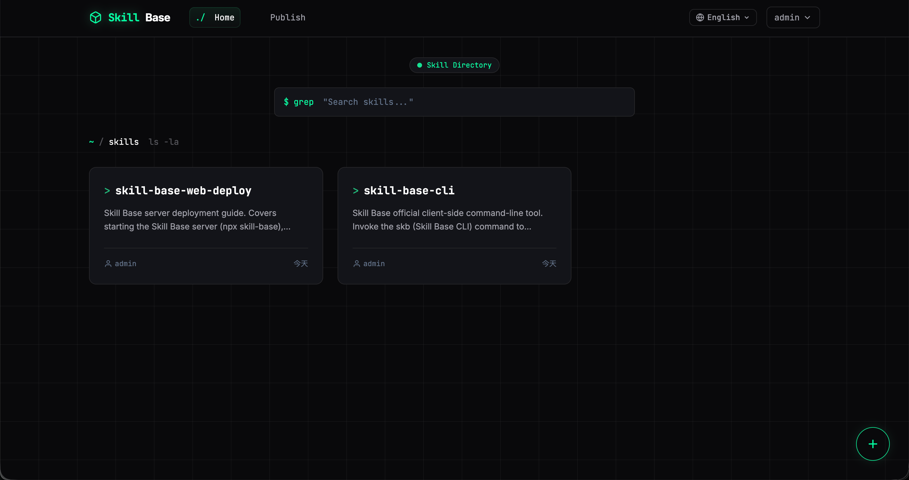
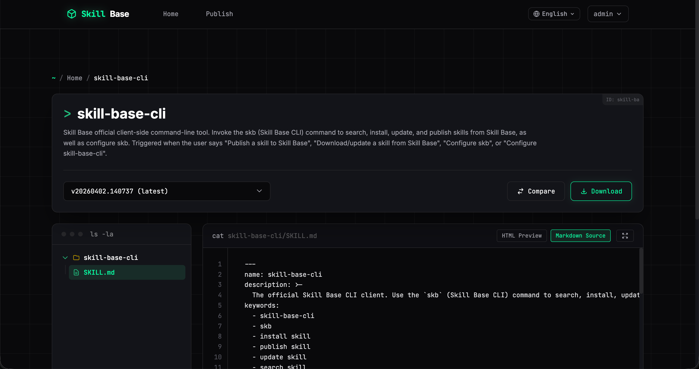

# 使用说明

[English](../usage.md) | **中文**

## 核心闭环

**一处发布，本地多处更新。** `skb install` 会记录 Skill 装到了哪些目录、对应哪个 IDE、当前版本（目前没有用软链接的方式，是考虑Windows 上会有坑）。当远程 Skill 更新后本地同步时：

```bash
skb update some-skill
```

只有一条安装记录就直接更新；多条会列出来让你选。研发用 CLI；PM、QA 可在 Web 端搜索、看版本、下载，不必碰 Git。也可以使用 Desktop 工具管理

```bash
skb search vue
skb install team-vue-rules --ide cursor
skb publish ./my-skill --changelog "补充接口鉴权规范"
```

公开 Skill 也可在详情页选择版本后切换到 **npx skills**，复制命令并在项目目录运行。命令使用该版本的公开 ZIP 下载地址；`npx skills add` 会按所选 Agent 的技能目录安装。私有 Skill 请使用 `skb install`。

## Skill 长什么样

Skill 是包含 `SKILL.md` 的目录。最小示例：

```markdown
---
name: team-vue3-admin
description: "Internal Vue3 admin best practices. Triggers on requests to create Vue admin pages, use ProTable, ProForm, or internal request utilities."
---

# 内部 Vue3 管理后台最佳实践

研发一部的中后台规范，覆盖表单、表格、请求封装和时间格式化。

## 核心原则

- 必须使用 TypeScript
- 表单统一使用 `ProForm`
- 表格统一使用 `ProTable`
- 请求统一使用 `@/utils/request`
```

省略 frontmatter 时，第一个 `#` 标题作名称，标题后第一段作描述 —— 仍建议显式写 `name` 和 `description`。

## Web 端

<p align="center">
  
</p>

<p align="center">
  
</p>

Web 端支持：

1. 浏览和搜索 Skill
2. 版本历史与 changelog
3. 下载技能包
4. 上传含 `SKILL.md` 的目录或 zip
5. 在发布页用 **公开** GitHub 仓库 URL 或 `owner/repo` 导入
6. 创建时设 `public` / `private`；所有者可事后修改
7. 私有 Skill 对非协作者隐藏列表、详情、版本与下载

**标签与收藏：** 管理员在 **标签管理**（`/admin/tags`）维护全局标签库；首页 **标签** 筛选为多选「或」语义；所有者与协作者在详情页打标。内联预览走 `/view`，浏览 ZIP 不计入下载次数。

## 桌面端

桌面端适合不想记命令和路径的场景：连接 Skill Base 服务后，可浏览团队 Skill、收藏、安装到 Cursor / Claude Code / Codex / Qoder 等 Agent 目录，并在「本地资产」里查看已安装 Skill 是否需要更新。安装包见 [桌面客户端](desktop.md)。

### GitHub 导入（服务端）

- `GET /api/v1/skills/import/github/connectivity` — **服务端**能否访问 GitHub（浏览器 VPN 不能代替）
- `SKILL_BASE_GITHUB_IMPORT_MAX_ZIP_MB`（默认 `50`）、`SKILL_BASE_GITHUB_CONNECTIVITY_TIMEOUT_MS`（默认 `8000`）
- 不支持私有 Github 仓库

**CLI：** `skb import-github owner/repo`（别名 `skb import`），支持 `--ref`、`--subpath`、`--target`、`--changelog`、`--dry-run`。

## OpenClaw 类助手

把下面内容发给助手（替换服务器地址与验证码）。**缩进引用块是可原样粘贴给 Claw 的文案。**

1. **从 ClawHub 安装 `skill-base-cli`**（对接已有站点）

   > 到 ClawHub 拉取 **skill-base-cli**，并安装到你的 skills 目录。

   日常 search / install / publish 够用；不必为 CLI 再装服务端部署 Skill。

2. **从 ClawHub 安装 `skill-base-web-deploy`**（部署或运维服务端）

   > 到 ClawHub 拉取 **skill-base-web-deploy**，并安装到你的 skills 目录。

   仅当助手需要起 Docker、管数据目录、做备份等**服务端工作**时安装。

3. **配置 CLI 指向服务端**

   > 帮我配置 Skill Base，服务器地址是 **`https://skill-base-server`**。

4. **搜索** — `> 用 skb 搜索 \`some-skill\`.`（一般不需登录）

5. **安装** — `> 用 skb 安装 \`some-skill\`.`（可用 `skill_id@版本` 或 `-d` / `--ide`）

6. **更新** — `> 用 skb 更新 \`some-skill\`。`

7. **登录** — `> 帮我 skb login，验证码是 **\`xxxx-xxxx\`**。` 来自浏览器流程或 `https://<主机>/cli-code`，五分钟有效。

8. **发布** — `> 调用 skb，发布刚写的 skill。` 可加 `--changelog`；也可让助手先写 changelog 文案。

仓库内两个 ClawHub Skill：

| Skill | 作用 |
|-------|------|
| **`skill-base-cli`** | 执行 **`skb`**：`init`、`login`、`whoami`、`search`、`install`、`update`、`publish` 等 |
| **`skill-base-web-deploy`** | 部署或运维服务端（`npx skill-base`、Docker、端口、备份） |

典型闭环：

1. **服务端** — `npx skill-base -d <数据目录> -p <端口>` 或连已有部署（服务端任务用 `skill-base-web-deploy`）。
2. **CLI 指向** — `skb init -s <站点根 URL>` → `~/.skill-base/config.json`（URL 不带 `/api`）。多个服务（如生产 / QA）用 `skb config add <name> -s <url>` 配合 `--profile <name>`。
3. **登录** — search/install 通常不需登录；**publish** 需要 `skb login`（浏览器或 `/cli-code` → 五分钟码 → 长期 PAT）。
4. **日常** — `skb search` / `install` / `update` / `publish`，发布时带 `--changelog "..."`。

本机也可 `npm install -g skill-base-cli` 或 `npx skill-base-cli`。

## Cappy

默认在终端启动和长等待时显示 ASCII 水豚 **Cappy**，不影响业务。

<p align="center">
  
</p>

关闭：

```bash
npx skill-base --no-cappy
```

## 相关文档

- [快速开始](getting-started.md)
- [CLI](cli.md)
- [桌面客户端](desktop.md)
- [API](api.md)
